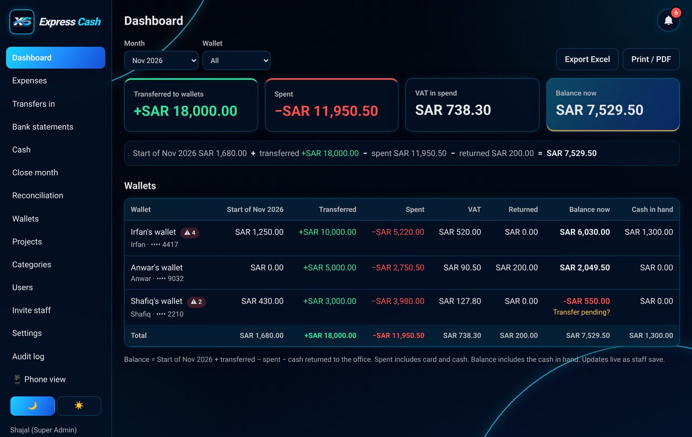
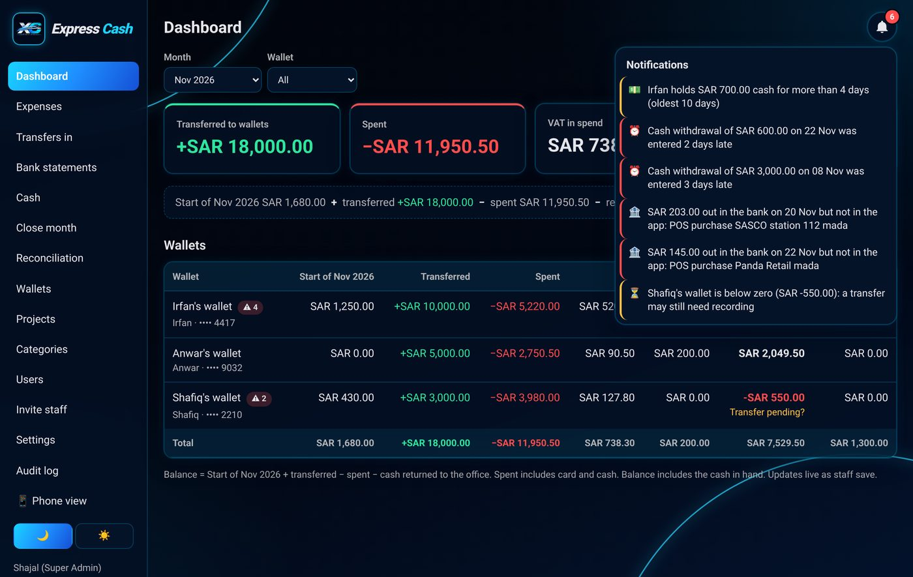
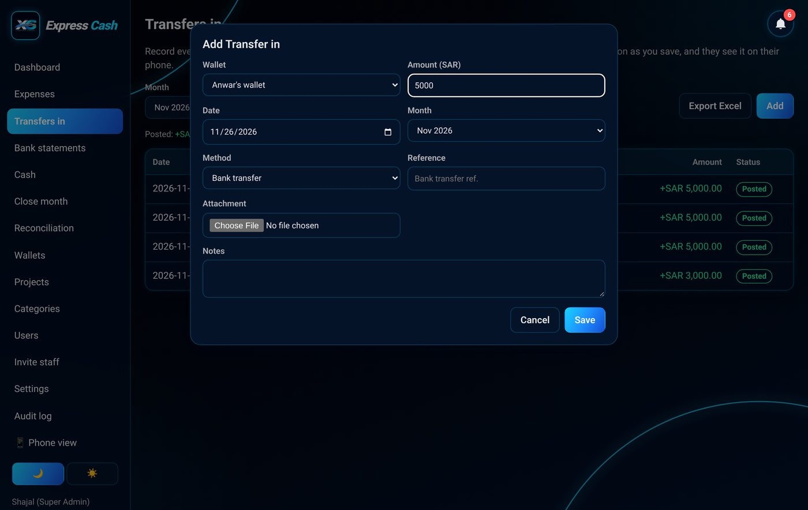
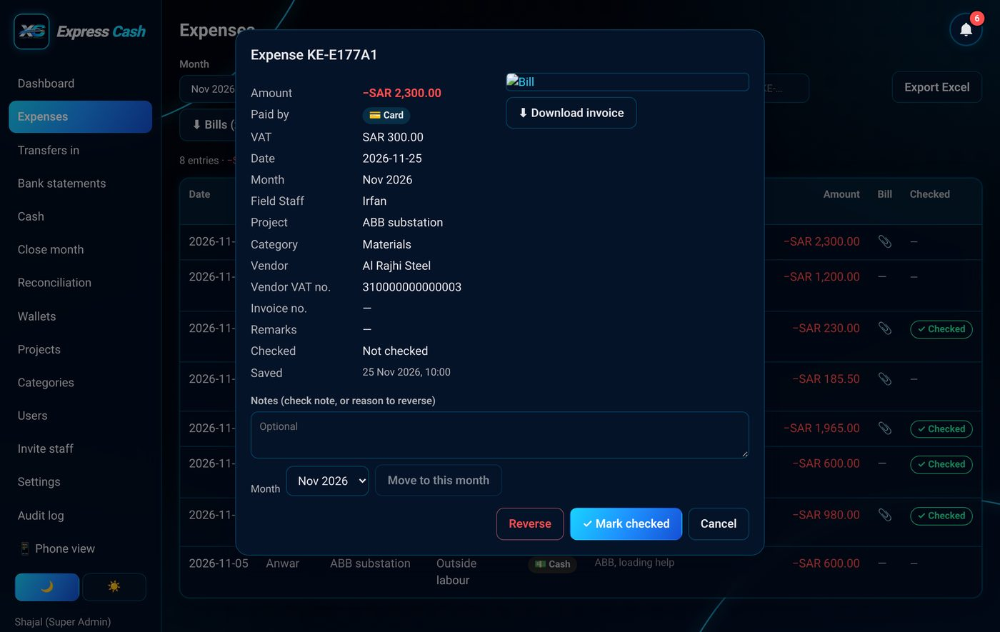
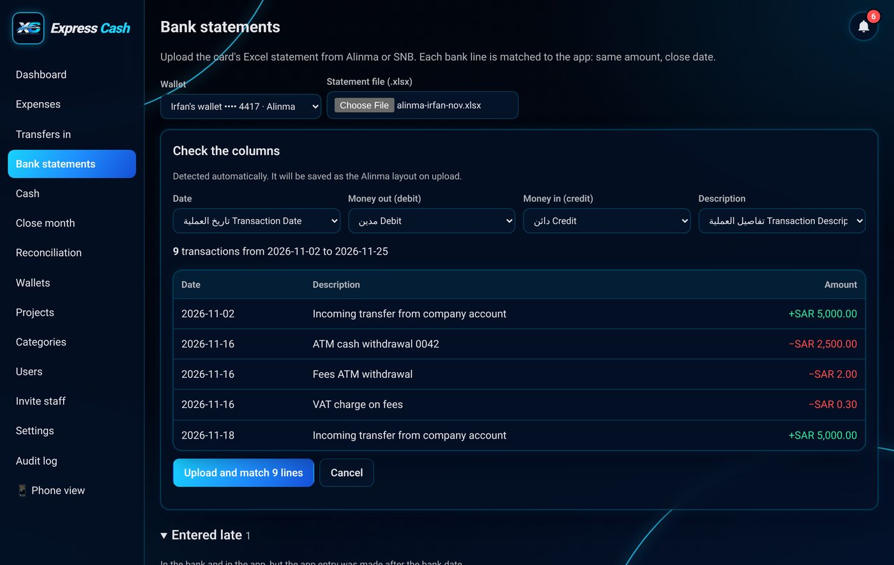
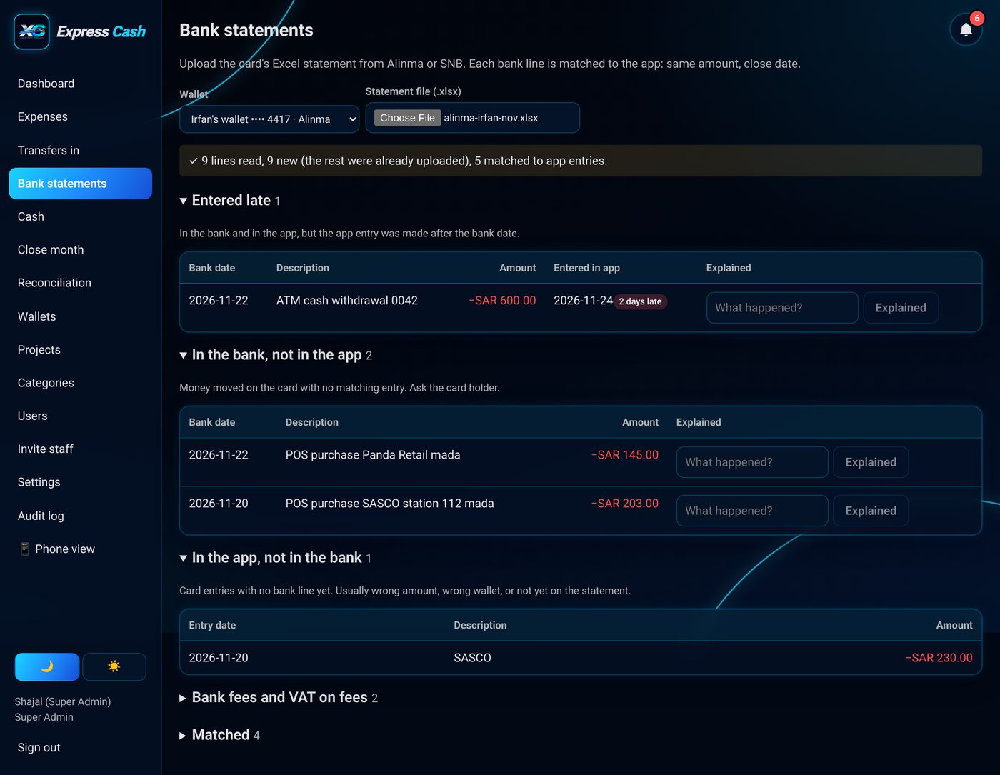
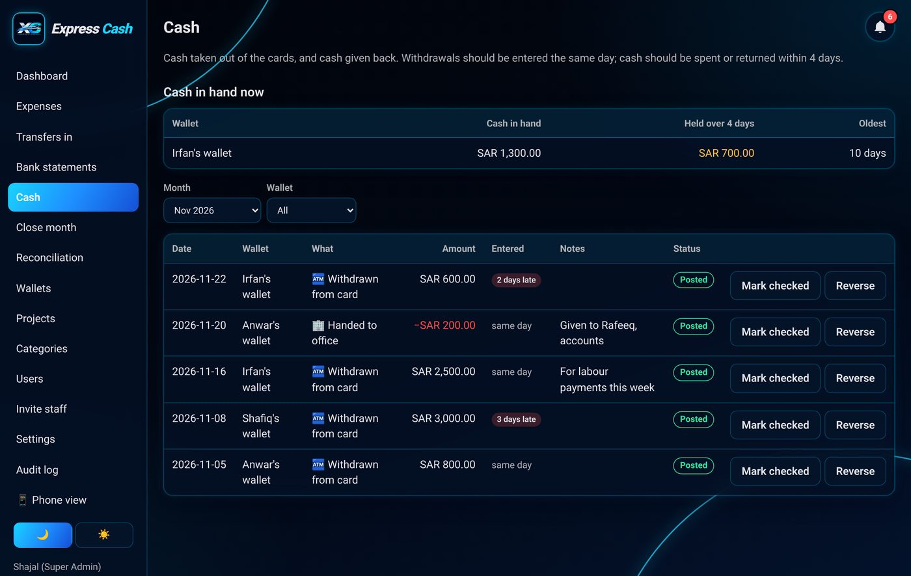
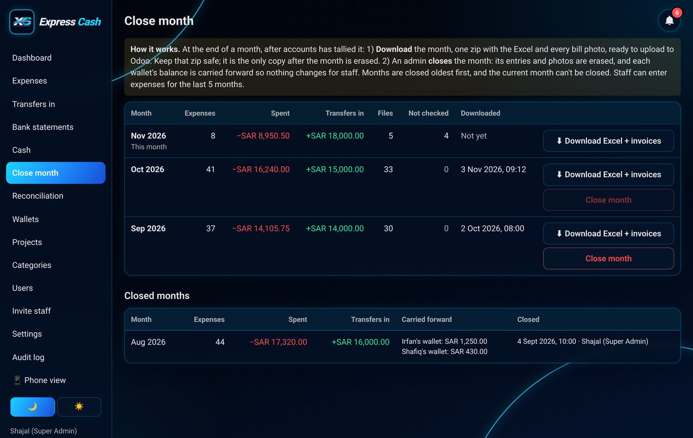
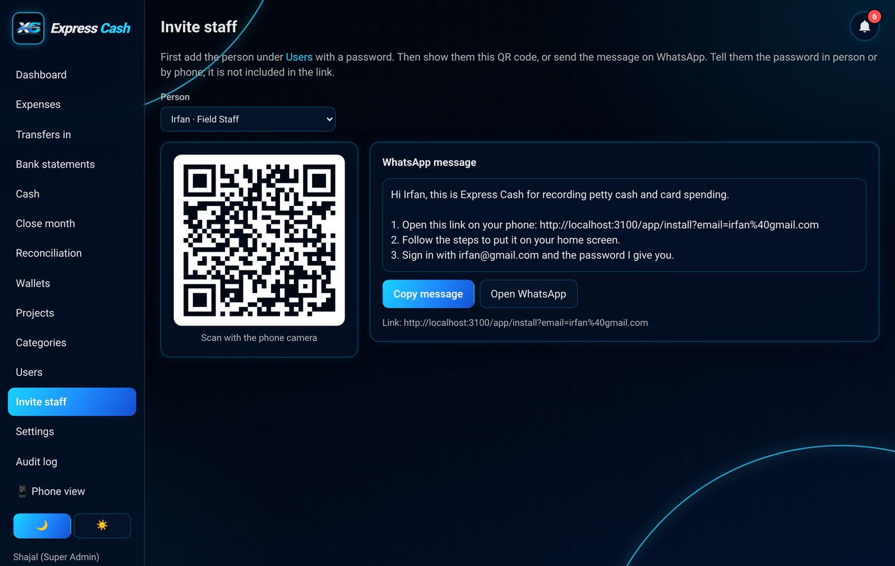
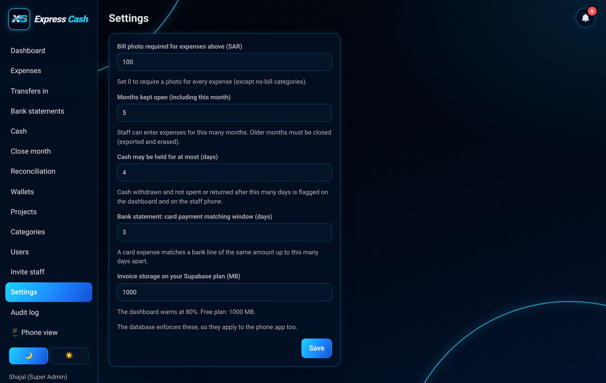

# Express Cash: quick guide for the Super Admin and Accounts

Open the app on a laptop, at the address from the setup guide. The Super Admin sets things up and records transfers to the cards. Accounts check the entries, upload bank statements and download the months.

### 1. Dashboard

For the chosen month, the dashboard shows money transferred to the wallets, money spent, VAT, and the balance left. The line underneath always adds up: start of month + transferred − spent − returned = balance. There is one row per card holder; ⚠ marks a wallet with warnings.

### 2. The bell

The bell collects everything to look at:

- cash held for more than 4 days
- cash withdrawals entered late
- bank lines missing from the app
- wallets below zero

Click an item to open it.

### 3. Transfers in (Super Admin only)

Record each transfer to a card on the day you send it: **Add**, pick the wallet, enter the amount, date and bank reference, then **Save**. The staff phone updates at once. A wallet may go below zero until you do this; nothing is blocked.

### 4. Expenses: check them

Every expense counts as soon as staff save it; there is no approval. Open an expense to see the bill. If it is right, click **Mark checked**; staff can no longer change it after that. If it is wrong, ask the staff member on WhatsApp. The Super Admin can also **Reverse** an entry made by mistake, giving a reason.

### 5. Bank statements (every week)

1. Download the card's statement from Alinma or SNB as Excel.
2. Choose the wallet and upload the file.
3. The first time, check that the columns are right. The app remembers them for that bank.
4. Click **Upload and match**.

### 6. Read the bank report

- **Entered late:** a cash withdrawal recorded days after the bank date.
- **In the bank, not in the app:** a payment nobody recorded. Ask the card holder, write what happened, and click **Explained**.
- **In the app, not in the bank:** often a typing mistake (230 entered for 203), or not on the statement yet.
- **Bank fees** are kept apart.

Uploading the same statement twice is safe: lines already uploaded are skipped.

### 7. Cash

This page shows who is holding cash and for how long. It lists every withdrawal and return, tagged with how many days late it was entered.

### 8. Close month (first week of each month)

1. Click **Download Excel + invoices** for the oldest month. Open the zip and check it, then keep it safe. It is the only copy, and it is what you import into Odoo.
2. Super Admin: click **Close month** and type the month to confirm. The month's entries and photos are erased to free space. Balances and cash in hand carry forward unchanged.

### 9. Add people and invite them (Super Admin)

Use **Users**, then **Invite user**, to add a person:

- **Field Staff** use the phone app.
- **Accounts** see everything.

Then open **Invite staff**. Show the person the QR code, or send the WhatsApp message. Tell them the password separately; it is never in the link.

### 10. Wallets and Settings (Super Admin)

**Wallets:** one per card holder, with their bank (Alinma or SNB) and the last 4 digits of the card. If someone leaves, give their wallet to someone else here.

**Settings:**

- bill photo limit (SAR 100)
- how long cash may be held (4 days)
- how many months stay open (5)
- bank matching window

---

**Every Sunday at 8 AM** the Super Admin gets an email with each wallet's card and cash balance, every warning, and the week's entries in Excel.
