# Express Cash: quick guide for card holders

Use this guide to record every card payment, cash withdrawal and returned cash on your phone, on the same day. It takes about a minute each time.

### 1. Put the app on your phone

Open the link or QR code your admin sends you. Follow the steps for iPhone (Safari) or Android (Chrome). Express Cash then sits on your home screen like any app.

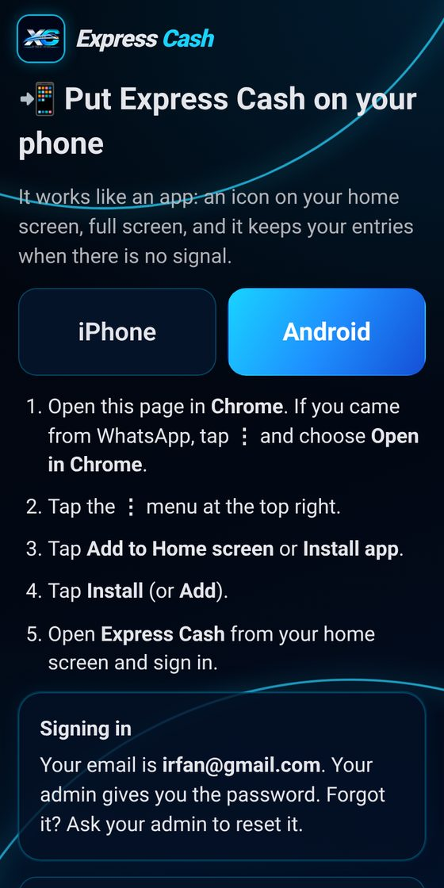

### 2. Sign in

Your email is already filled in. Type the password your admin gave you. To change it later, open the ☰ menu and tap **Change password**.

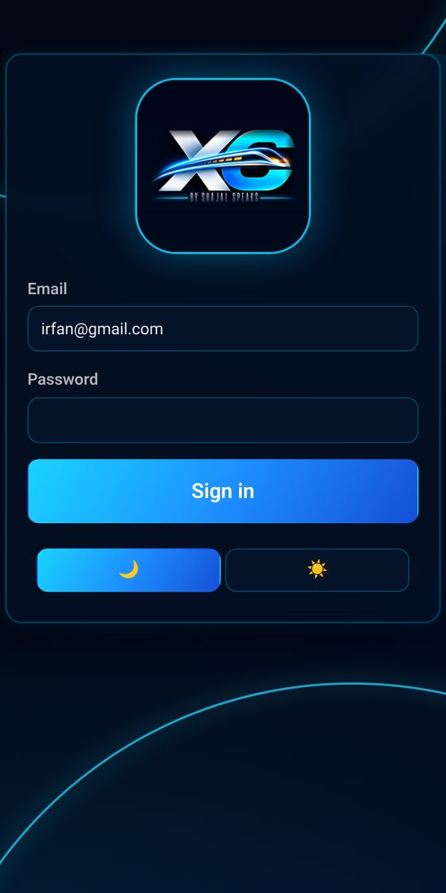

### 3. Your wallet

- **On card:** what is left on your company card.
- **Cash in hand:** cash you took out and have not spent or returned yet.
- **Wallet balance:** both together. If it goes below zero, keep working; the office has to record a transfer.

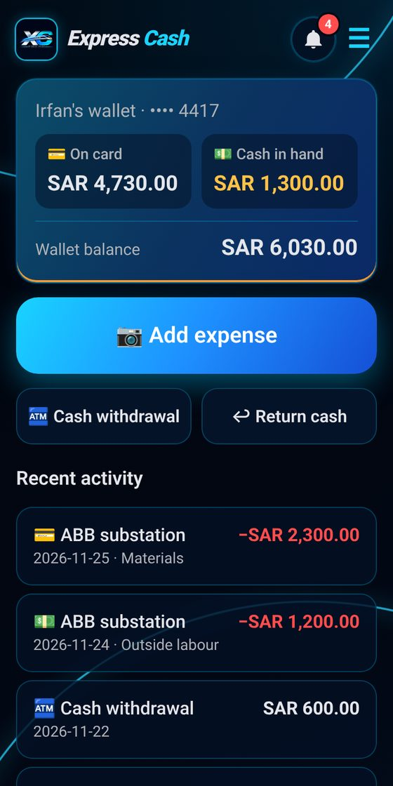

### 4. The bell

A number on the bell means something needs your attention. For example, you have held cash for more than 4 days, or the bank shows a payment you did not enter. Tap the bell to see the list.

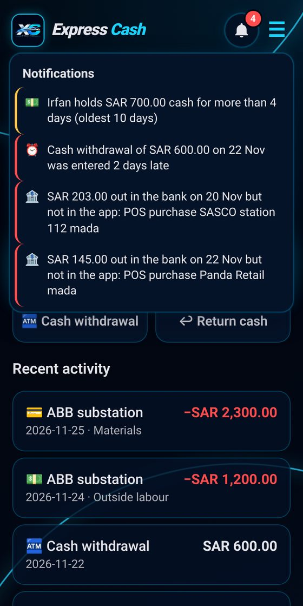

### 5. Add an expense: take a photo of the bill

Tap **Add expense**, then **Take photo**. If the bill has a QR code, the amount, VAT and shop name fill in by themselves.

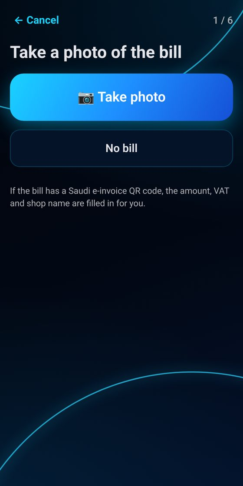

### 6. Pick the project

Tap the project. You can also hold the microphone and say the project name.

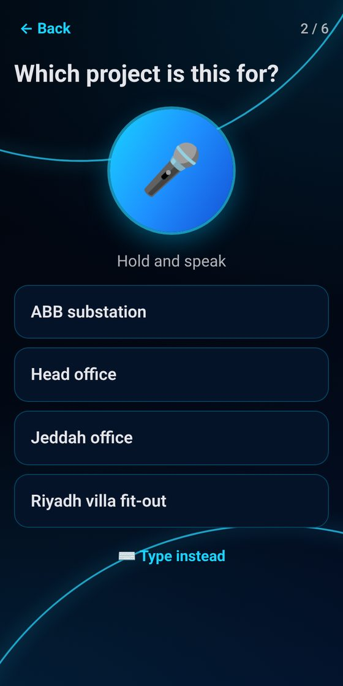

### 7. What was it for, and card or cash?

Choose the category, then **Card** (you swiped the company card) or **Cash** (you paid with cash taken from the card).

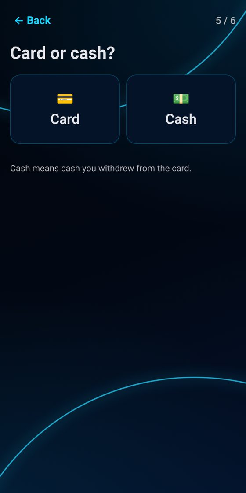

### 8. Check and save

Check the amount, project and date, then tap **Save**. With no signal, it waits on your phone and sends itself later.

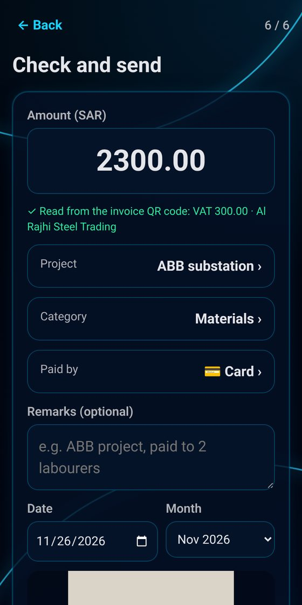

### 9. No bill?

Example: paying labourers. Tap **Add expense**, then **No bill**, type the amount, and write clear remarks, such as "ABB project, paid to 2 labourers".

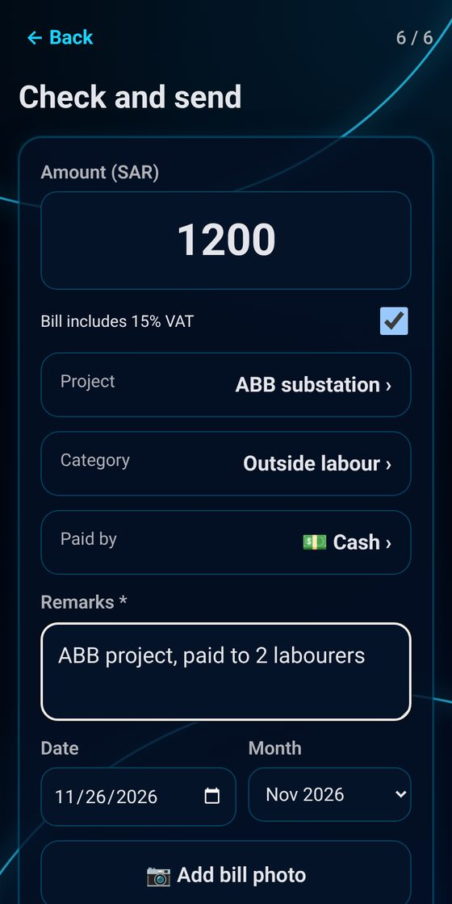

### 10. Took cash out of the card?

Tap **Cash withdrawal** and enter the amount **the same day**. Late entries are flagged when accounts check the bank statement. Spend the cash on the project within 4 days, or return it.

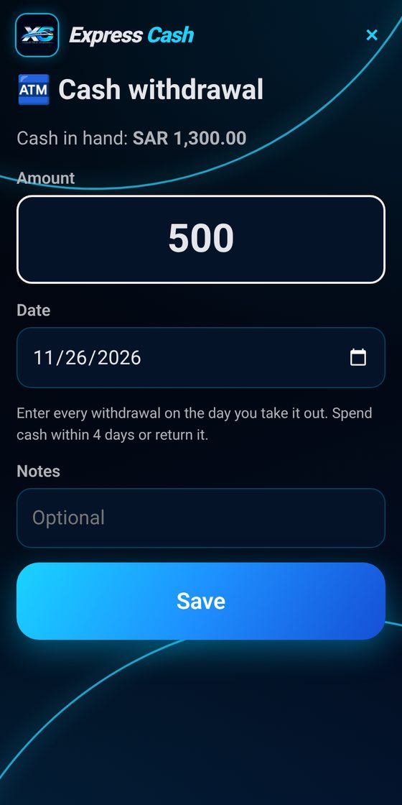

### 11. Return cash

Tap **Return cash**, then choose:

- **Put back on the card:** you deposited it at an ATM or the bank. Your wallet total stays the same.
- **Handed to the office:** you gave it to accounts. Write who you gave it to.

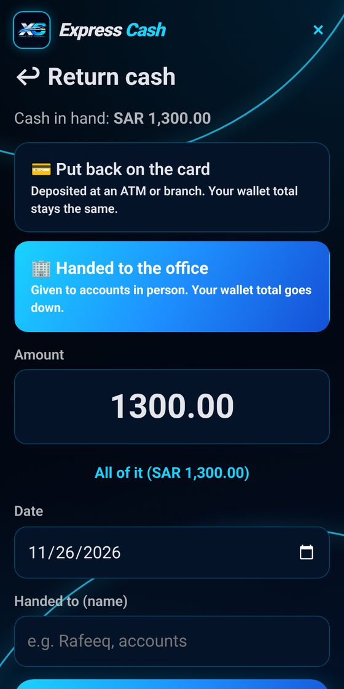

### 12. Made a mistake?

Tap the expense under **Recent activity**, then **Correct this expense**. You can change it until accounts tick it as checked. After that, message accounts on WhatsApp.

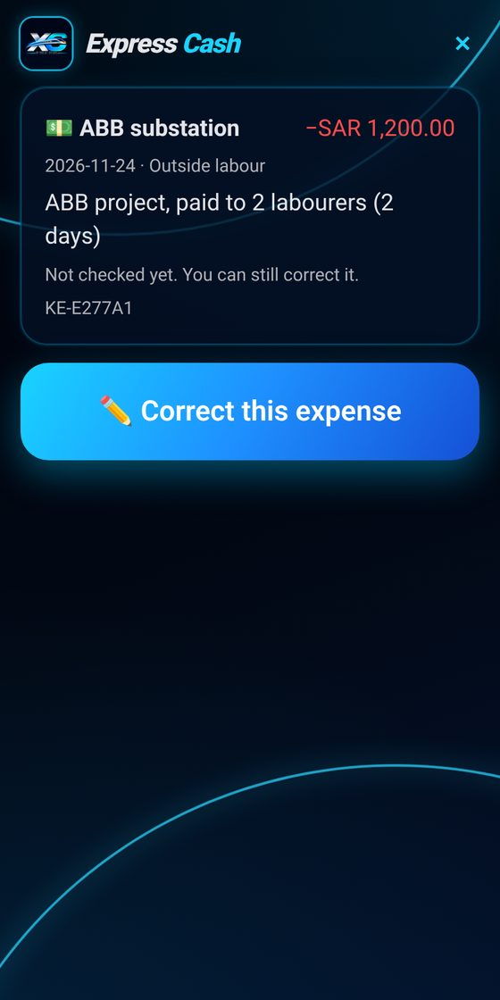

---

**Rules to remember**

1. Enter every payment and every cash withdrawal on the same day.
2. Take a photo of every bill. No bill? Write clear remarks.
3. Do not hold cash for more than 4 days. Spend it on the project or return it.
4. Questions go to accounts on WhatsApp.
